# Apartado de CI/CD: Arquitectura de Integración y Despliegue Continuo

Este documento define la arquitectura, compuertas de calidad, políticas de ejecución y procedimientos de despliegue continuo de la aplicación Android **Sensus Mobile**, conforme a la [constitution.md (§8)](../constitution.md#L101-L115).

---

## 1. Visión General de los Flujos de Trabajo

El pipeline de Sensus Mobile está compuesto por tres workflows orquestados en GitHub Actions:

```mermaid
flowchart TD
    subgraph CI["1. Integración Continua (ci.yml)"]
        W[validate-wrapper] --> G[sdd-gates]
        G --> S[security-scan CodeQL]
        S --> L[static-analysis Lint]
        L --> T[unit-test JUnit 5]
        T --> I[instrumentation-compile]
        I --> B[build Release Verify]
        B --> SUM1[Dashboard CI/CD en Step Summary]
    end

    subgraph SEC["2. Suite de Seguridad (security-scanners.yml)"]
        SS1[TruffleHog & Gitleaks] --> SS2[Semgrep & MobSFscan]
        SS2 --> SS3[Detekt & Ktlint]
        SS3 --> SS4[OSV-Scanner & Trivy]
        SS4 --> SS5[OWASP Dependency-Check]
        SS5 --> SS6[SonarCloud & Snyk]
        SS6 --> SUM2[Resumen SARIF & Seguridad]
    end

    subgraph CD["3. Despliegue a Play Store (release-playstore.yml)"]
        PRE[pre-flight-gates: Bloqueante] --> CHK{¿Todos los Gates OK?}
        CHK -- No --> STOP[🛑 CANCELACIÓN TOTAL: Bloqueo de Despliegue]
        CHK -- Sí --> ENV{¿Credenciales en GitHub Secrets?}
        ENV -- No --> PAUSE[⏸️ Pausa de publicación + Verificación Release]
        ENV -- Sí --> DEPLOY[🚀 Firma efímera + Publicación en Play Console]
        DEPLOY --> SUM3[Resumen de Despliegue en Step Summary]
    end
```

---

## 2. Los Tres Flujos de CI/CD

### A. Integración Continua (`.github/workflows/ci.yml`)
* **Disparador:** Cada Pull Request hacia `main` y cada `push` en `main`.
* **Propósito:** Validar que ninguna contribución rompa la compilación, la arquitectura ni las invariantes de dominio.
* **Compuertas:**
  1. `validate-wrapper`: Verifica la suma criptográfica de `gradle-wrapper.jar`.
  2. `sdd-gates`: Ejecuta los 5 validadores en Python (`check_sdd`, `check_layers`, `check_endpoints`, `check_secrets`, `check_coverage`).
  3. `security-scan`: Análisis estático semántico de flujos con CodeQL (Java/Kotlin).
  4. `static-analysis`: Android SDK Lint oficial.
  5. `unit-test`: Pruebas unitarias de dominio y ViewModels (JUnit 5 + MockK + Turbine) con umbral mínimo obligatorio del 80%.
  6. `instrumentation-compile`: Valida que los tests instrumentados compilen.
  7. `cicd-summary`: Genera el **Apartado CI/CD** en el Step Summary de GitHub Actions.

### B. Suite de Escaneo de Seguridad (`.github/workflows/security-scanners.yml`)
* **Disparador:** Push a `main`, Pull Requests y ejecución recurrente semanal (Lunes 03:00 UTC).
* **Propósito:** Auditoría exhaustiva mediante 14 herramientas combinadas (SAST, SCA, Secret Scanning, Mobile Security y Linters).
* **Consolidación:** Sube reportes SARIF a la pestaña de Seguridad (`Security > Code scanning`) de GitHub.

### C. Despliegue Continuo a Google Play Console (`.github/workflows/release-playstore.yml`)
* **Disparador:** Manual vía `workflow_dispatch` (seleccionando pista y fracción de rollout) o activado automáticamente por tags de versión formal `v*.*.*`.
* **Políticas clave:**
  1. **Quality Gate Estricto:** Si `pre-flight-gates` falla en cualquier prueba o escáner, el despliegue a Google Play Console se cancela.
  2. **Tolerancia a Entorno No Listo:** Si los secretos de producción aún no han sido cargados en GitHub Secrets, el workflow valida la compilación de Release y pausa la publicación de forma limpia.
  3. **Firma Efímera:** El Keystore se decodifica en la memoria del runner (`${{ runner.temp }}`) y se destruye en el paso de limpieza al terminar el job.

---

## 3. Matriz de Variables y Secretos Requeridos

| Secreto / Variable | Requerido Para | Dónde se Configura | Descripción |
|---|---|---|---|
| `PLAY_STORE_SERVICE_ACCOUNT_JSON` | CD Play Store | GitHub Secrets | JSON de la Service Account de Google Cloud vinculada a Play Console |
| `KEYSTORE_BASE64` | CD Play Store | GitHub Secrets | Archivo `.jks` codificado en base64 |
| `SIGNING_STORE_PASSWORD` | CD Play Store | GitHub Secrets | Contraseña del almacén de claves (Keystore) |
| `SIGNING_KEY_ALIAS` | CD Play Store | GitHub Secrets | Alias de la llave de subida de release |
| `SIGNING_KEY_PASSWORD` | CD Play Store | GitHub Secrets | Contraseña de la llave de release |
| `SONAR_TOKEN` | SAST (Opcional) | GitHub Secrets | Token para escaneo en SonarCloud.io |
| `SNYK_TOKEN` | SCA (Opcional) | GitHub Secrets | Token API de Snyk.io |

---

## 4. Visualización en GitHub Actions (Step Summary)

Cada ejecución de los flujos de CI/CD genera automáticamente un reporte visual en el apartado de **Step Summary** de GitHub Actions, detallando:
* Estado booleano de cada etapa (✅ Aprobado / ❌ Fallido).
* Indicador de cobertura de pruebas.
* Estado de publicación en Google Play Console (Pista, Porcentaje de Rollout, Versión).
