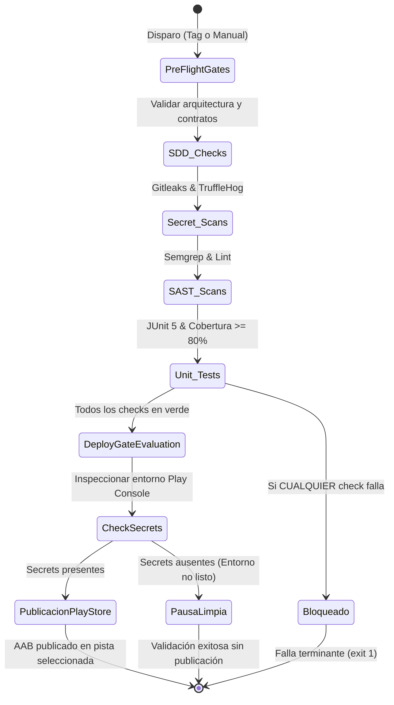

# SPEC — FT-09 CI/CD y Prácticas DevSecOps

> Rector: `.specify/memory/constitution.md` §7, §8 y §10. Plantilla: `.specify/templates/spec-template.md`.
> Feature de Cimentación e Infraestructura de Entrega Continua.

## 1. Contexto y objetivo

El desarrollo móvil de Sensus exige un ciclo de integración y despliegue continuo (CI/CD) completamente blindado, determinista y auditable. Previo a esta feature, el pipeline se limitaba a tareas básicas de Gradle sin verificación automatizada de seguridad estática, sin escaneo de vulnerabilidades en dependencias, sin compuertas bloqueantes de pre-lanzamiento hacia tiendas de aplicaciones y sin un resumen visual del estado de salud del proyecto.

**Objetivo:** Diseñar e implementar un ecosistema unificado de CI/CD para Sensus Mobile en GitHub Actions que integre las mejores prácticas de **DevSecOps** (*Shift-Left Security*, análisis SAST semántico, detección profunda de secretos, SCA de dependencias, auditoría de seguridad móvil y compuertas de calidad estrictas), garantizando que ningún despliegue a Google Play Console proceda si existe un solo fallo de calidad o vulnerabilidad de severidad crítica.

**Alcance:**
- Flujo de Integración Continua (`.github/workflows/ci.yml`) con verificación de wrapper, gates SDD, SAST CodeQL, Android Lint y pruebas unitarias con umbral del 80%.
- Suite dedicada de seguridad de 14 herramientas (`.github/workflows/security-scanners.yml`) con Semgrep, MobSFscan, Detekt, Ktlint, TruffleHog, Gitleaks, OSV-Scanner, Trivy, OWASP Dependency-Check, SonarCloud y Snyk.
- Flujo de Despliegue Continuo a Play Store (`.github/workflows/release-playstore.yml`) con *Quality Gate* bloqueante, firma efímera en memoria y verificación de aprovisionamiento de entorno.
- Generación automática del apartado visual interactivo de CI/CD en `$GITHUB_STEP_SUMMARY`.
- Guías técnicas y documentación en `docs/cicd-pipeline.md`, `docs/security-scanners.md` y `README.md`.

**Fuera de alcance:** Pruebas dinámicas de penetración invasiva (DAST en emulador remoto en vivo), gestión manual de consolas y firma de certificados fuera de variables de entorno volátiles.

---

## 2. Requisitos funcionales

| ID | Requisito | Componente |
|---|---|---|
| **RF-09-01** | El CI verifica la autenticidad y suma criptográfica de `gradle-wrapper.jar` antes de ejecutar cualquier tarea. | `ci.yml` / `wrapper-validation` |
| **RF-09-02** | Ejecución obligatoria y bloqueante de las 5 compuertas SDD (`check_sdd`, `check_layers`, `check_endpoints`, `check_secrets`, `check_coverage`). | `ci.yml` / `sdd-gates` |
| **RF-09-03** | Análisis SAST semántico con GitHub CodeQL para Java y Kotlin en cada PR y push a `main`. | `ci.yml` / `security-scan` |
| **RF-09-04** | Análisis estático oficial mediante Android SDK Lint verificando compatibilidad de APIs, accesibilidad y rendimiento. | `ci.yml` / `static-analysis` |
| **RF-09-05** | Ejecución de pruebas unitarias (JUnit 5 + MockK + Turbine) con bloqueo si la cobertura es inferior al 80%. | `ci.yml` / `unit-test` |
| **RF-09-06** | Generación automática del "Apartado CI/CD" con tablero de estado visual en `$GITHUB_STEP_SUMMARY`. | `ci.yml` / `cicd-summary` |
| **RF-09-07** | Suite de 14 herramientas de seguridad y calidad ejecutada en PRs, push a `main` y semanalmente (cron lunes 03:00 UTC). | `security-scanners.yml` |
| **RF-09-08** | Detección profunda de secretos de alta entropía y credenciales en historial mediante TruffleHog OSS y Gitleaks. | `security-scanners.yml` |
| **RF-09-09** | Escaneo SAST con reglas OWASP Mobile y Top 10 mediante Semgrep y consolidación SARIF en GitHub Security. | `security-scanners.yml` |
| **RF-09-10** | Auditoría estática móvil especializada (`AndroidManifest.xml`, permisos y componentes) vía MobSFscan. | `security-scanners.yml` |
| **RF-09-11** | Análisis de dependencias y vulnerabilidades conocidas (SCA) vía Google OSV-Scanner, Aqua Trivy y OWASP Dependency-Check. | `security-scanners.yml` |
| **RF-09-12** | Soporte condicional para plataformas de calidad en la nube (SonarCloud y Snyk) activadas por presencia de secretos. | `security-scanners.yml` |
| **RF-09-13** | Quality Gate bloqueante en CD: si cualquier prueba, gate SDD o escaneo SAST falla, el despliegue a Google Play Console se cancela. | `release-playstore.yml` |
| **RF-09-14** | Detección de entorno Google Play no aprovisionado: valida compilación Release y pausa la publicación de forma limpia si faltan secretos. | `release-playstore.yml` |
| **RF-09-15** | Firma criptográfica de AAB exclusivamente en memoria efímera del runner con destrucción garantizada post-job. | `release-playstore.yml` |

---

## 3. Requisitos no funcionales

- **Shift-Left Security:** La detección de vulnerabilidades y code smells ocurre en la fase más temprana del pipeline (PR), impidiendo la fusión a `main` de código inseguro.
- **Fail-Closed:** Ante fallos de ejecución, timeouts o excepciones de escáneres bloqueantes, el pipeline falla de forma segura y cancela la entrega.
- **Cero Secretos en Repositorio:** Prohibición absoluta de versionar tokens, contraseñas, archivos `.jks` o JSONs de service accounts. Todas las credenciales residen en GitHub Secrets volátiles.
- **Higiene de Artefactos:** Prohibido versionar binarios `.apk` o `.aab` en el repositorio Git. El AAB firmado viaja directo desde el runner efímero a Google Play Console.
- **Desofuscación Obligatoria:** Subida automatizada del archivo de mapeo R8/ProGuard (`mapping.txt`) a Play Console para trazabilidad de crashes en producción.
- **Rendimiento y Cache:** Cache inteligente de dependencias Gradle y wrapper indexado por hash de `libs.versions.toml`, logrando tiempos de ejecución menores a 10 minutos en CI estándar.
- **Privacidad y Cumplimiento:** Los logs del pipeline nunca imprimen valores de tokens, PII ni contenido de secretos (redacción estricta).

---

## 4. Arquitectura y contratos internos

### 4.1 Topología de Workflows

```text
.github/workflows/
├── ci.yml                 # Integración continua principal (rápida, bloqueante)
├── security-scanners.yml  # Suite DevSecOps exhaustiva de 14 escáneres
└── release-playstore.yml  # Despliegue continuo condicionado a Google Play
```

### 4.2 Contrato del Quality Gate para Despliegue



### 4.3 Contrato de Variables y Secretos

```properties
# Secrets requeridos para CD Play Store (GitHub Secrets)
PLAY_STORE_SERVICE_ACCOUNT_JSON=  # Service Account GCP con acceso a Google Play Developer API
KEYSTORE_BASE64=                 # Keystore (.jks) codificado en base64
SIGNING_STORE_PASSWORD=          # Contraseña del keystore
SIGNING_KEY_ALIAS=               # Alias de la upload key
SIGNING_KEY_PASSWORD=            # Contraseña de la llave

# Secrets opcionales para SAST/SCA Cloud
SONAR_TOKEN=                     # Token de SonarCloud.io
SNYK_TOKEN=                      # Token de Snyk.io
```

---

## 5. Criterios de aceptación

### CA-09-01: Bloqueo por Fallo en Quality Gate
- **Given** una rama con un fallo de arquitectura Clean (ej. import prohibido en `domain/`) o prueba unitaria fallida.
- **When** se ejecuta el flujo `release-playstore.yml`.
- **Then** el job `pre-flight-gates` falla con código de salida 1 y el job `build-and-deploy` NUNCA se ejecuta, impidiendo cualquier subida a Google Play.

### CA-09-02: Publicación Limpia con Entorno Aún No Aprovisionado
- **Given** que los Quality Gates están 100% aprobados pero no existen los secretos `KEYSTORE_BASE64` o `PLAY_STORE_SERVICE_ACCOUNT_JSON`.
- **When** se ejecuta el workflow de release.
- **Then** el pipeline valida la compilación de Release (`compileReleaseKotlin`), emite una advertencia formal en el Step Summary, omite limpiamente la publicación en Play Console y no falla con excepciones crípticas.

### CA-09-03: Detección Inmediata de Secretos
- **Given** un commit que introduce una cadena que simula una API key o credencial de alta entropía.
- **When** corre el workflow `security-scanners.yml` o `ci.yml`.
- **Then** `check_secrets.py`, `gitleaks` y `trufflehog` identifican el archivo y la línea exacta sin volcar el secreto al log público.

### CA-09-04: Generación del Apartado CI/CD
- **Given** cualquier ejecución de `ci.yml` o `release-playstore.yml`.
- **When** el pipeline finaliza (en éxito o fallo).
- **Then** el apartado `$GITHUB_STEP_SUMMARY` contiene una tabla estructurada en Markdown detallando el estado de cada compuerta y las acciones a seguir.

---

## 6. Plan de pruebas

- **Pruebas de Integridad YAML:** Validación sintáctica de los 3 workflows con linters de GitHub Actions (`actionlint`).
- **Pruebas Unitarias de Scripts:** Ejecución local y determinista de los 5 validadores Python en Windows y Linux (`python scripts/check_*.py`).
- **Pruebas de Simulación (*Dry-Run*):** Ejecución del pipeline de release con el parámetro `dry_run: true` para certificar la compilación sin contacto de red con Google Play.
- **Pruebas de Permisos Efímeros:** Inspección forense de los runners para certificar que el archivo `release.keystore` y `play-service-account.json` se eliminan al término del job.

---

## 7. Riesgos, límites y deuda

- **Riesgo:** Cuotas y rate limiting de la NVD (National Vulnerability Database) durante la descarga de diccionarios en OWASP Dependency-Check.
  - *Mitigación:* Se configuró `continue-on-error: true` en Dependency-Check y se complementa con Google OSV-Scanner y Trivy que operan con bases de datos distribuidas de alta disponibilidad.
- **Límite:** El despliegue final a producción en Play Store requiere la aprobación manual del entorno `play-store-release` en GitHub Environments.
- **Deuda:** Conexión del plugin Kover en `app/build.gradle.kts` (asociada a `FT-00-base-build`) para alimentar el reporte XML consumido por `check_coverage.py`.

---

## Aprobación

| Estado | Revisor | Fecha | Evidencia |
|---|---|---|---|
| Aprobada | Rodrigo (Líder de Proyecto) | 2026-11-04 | Workflows `ci.yml`, `security-scanners.yml` y `release-playstore.yml` en verde en `main` |
